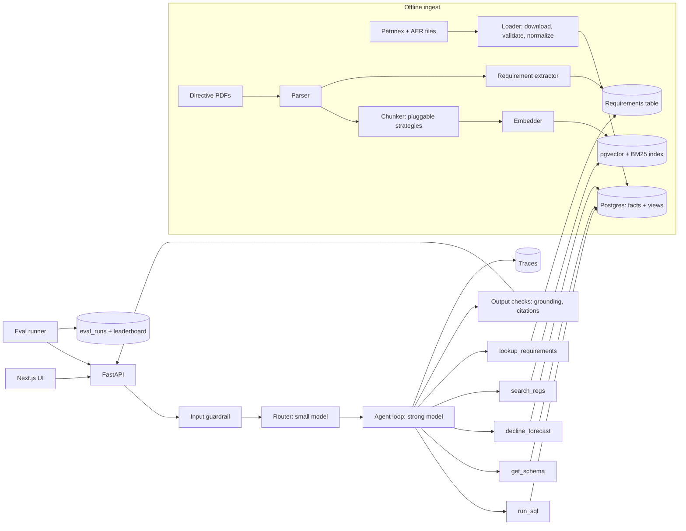

# Energy Copilot — Design Doc

_Working name. Author: Hetang Mehta. Status: draft v0.2, October 2026._

An AI copilot that answers plain-English questions about Alberta oil and gas wells using public regulator data. It writes SQL, runs production forecasts, searches and cites regulations, and extracts structured requirements from regulatory documents. Every answer is traceable, and every component is measured against versioned evaluation sets.

The project is built to exercise the core skills of an AI engineer (RAG, agents, evals, LLMOps) and a forward deployed engineer (discovery with users, messy data, deployment, demos and handoff). §16 maps each skill to where it's practised.

---

## 1. Goals and non-goals

**Goals**

- Answer factual and analytical questions over public Alberta production data, with the SQL and sources shown.
- Forecast a well's production with a standard decline-curve model.
- Answer "what does the rule say" questions from public AER directives, with citations to the section.
- Extract numbered requirements from directives into a structured, searchable table.
- Prove quality with numbers: every component has an eval suite, every change is compared against a baseline, and CI blocks regressions.
- Run the project like a customer deployment: discovery interviews, a scoping doc, user testing, a demo and a handoff runbook.

**Non-goals**

- No proprietary or employer data, ever. Public sources only.
- No write access to any database. The agent can read, never modify.
- Not a commercial product. The data licence forbids commercial reproduction without consent (see §3).
- No oil sands or Saskatchewan data in v1 (oil sands isn't in the public volumetric files).

## 2. Users and example questions

Primary user: a production or exploitation engineer who knows the domain but not SQL. The real user needs get confirmed through discovery interviews (§13) before v1 is final.

| Type               | Example                                                                | Components                   |
| ------------------ | ---------------------------------------------------------------------- | ---------------------------- |
| Lookup             | "Who operates facility ABBT0012345 and what's its subtype?"            | SQL                          |
| Aggregation        | "Top 10 operators by oil volume in 2025."                              | SQL                          |
| Trend              | "How did gas production for operator X's batteries change since 2022?" | SQL, chart                   |
| Forecast           | "Forecast this well's oil rate for 24 months and estimate EUR."        | SQL, decline curve           |
| Regulatory         | "What does Directive 017 require for gas measurement at a battery?"    | RAG                          |
| Requirement lookup | "List every requirement in Directive 007 that applies monthly."        | Extracted requirements table |
| Mixed              | "Which of my wells report flaring, and what's the reporting rule?"     | SQL + RAG                    |
| Unanswerable       | "Show me production for confidential well X."                          | Must refuse correctly        |

## 3. Data sources and constraints

| Source                                                                                                   | Contents                                                                                            | Refresh                                         | Access                           |
| -------------------------------------------------------------------------------------------------------- | --------------------------------------------------------------------------------------------------- | ----------------------------------------------- | -------------------------------- |
| [Petrinex Alberta Public Data](https://www1.aer.ca/ProductCatalogue/718.html) — conventional volumetrics | Monthly volumes by reporting facility, activity, product, from/to (well or facility), hours, energy | Monthly, ~1–2 month lag; rolling ~5-year window | Free, CSV via portal or API path |
| Petrinex infrastructure files                                                                            | Well licences, well-to-facility links, facility types, business associates (operators)              | Monthly                                         | Free                             |
| [AER ST37 List of Wells](https://www1.aer.ca/productcatalogue/10.html)                                   | Surface/bottom hole locations, well geometry                                                        | Monthly                                         | Free package (Excel / shapefile) |
| AER directives (e.g. 007, 017, 060)                                                                      | Reporting, measurement and flaring rules; long PDFs with numbered sections, requirements and tables | Ad hoc                                          | Public PDFs                      |

**Constraints that shape the design**

- **Licence:** Crown copyright; no commercial reproduction. → The repo ships the _loader_, not the data. Raw files are gitignored and fetched at build time. Prior art to read first: [petrinex-etl](https://github.com/rbhughes/petrinex-etl).
- **Masked rows:** some values are `***` for confidential wells. → Stored as NULL with a `masked` flag; the agent must say "this is confidential" rather than guess.
- **Units:** gas in e3m³, liquids in m³. → Units live in the semantic layer and every numeric answer states them.
- **Scale:** ~8 MB per monthly zip, a few hundred MB total. Small enough for one Postgres instance.
- **Documents are hard to parse:** directives mix prose, numbered requirements, tables and footnotes. → Parsing quality is measured (§8.4), not assumed.

## 4. Architecture



**Components**

1. **Loader** (Python): downloads monthly files, validates row counts and types, converts masked values, upserts into fact tables. Idempotent per month.
2. **Semantic layer:** curated SQL views (`well_monthly`, `facility_monthly`, `operator_monthly`) plus a data dictionary with each column's meaning, unit and common joins. The agent queries views, not raw tables.
3. **Document pipeline:** parser → chunker → embedder → index. Each stage is a swappable component chosen by config, so strategies can be compared (§7).
4. **Requirement extractor:** turns numbered requirements in directives into rows (`directive`, `section`, `requirement_id`, `text`, `applies_to`, `frequency`), using structured LLM output validated against a schema.
5. **Guardrails:** an input check (off-topic, out-of-scope data, injection attempts) and output checks (every number grounded in a tool result, every regulatory claim cited).
6. **Router** (small, cheap model): classifies the question and restricts which tools the agent may use.
7. **Agent loop** (strong model): plans, calls tools, inspects results, composes the answer. Hard limits on steps, tokens and cost.
8. **Tools:** `get_schema`, `run_sql`, `decline_forecast`, `search_regs`, `lookup_requirements` (details in §5).
9. **API** (FastAPI): streams the answer, SQL, chart spec and citations; accepts thumbs up/down feedback.
10. **UI** (Next.js): chat, inline chart, a "how I got this" panel (SQL, tool calls, retrieved passages), source links, feedback buttons.
11. **MCP server:** exposes the same tools to any MCP-capable agent.
12. **Eval runner:** runs any eval suite against any config and stores results (§8).

## 5. Tools

| Tool                  | Input                                      | Output                                                          | Guardrails                                                                       |
| --------------------- | ------------------------------------------ | --------------------------------------------------------------- | -------------------------------------------------------------------------------- |
| `get_schema`          | the question                               | relevant views + dictionary entries only                        | —                                                                                |
| `run_sql`             | a query                                    | rows + the query                                                | parsed, SELECT-only, allowed views, forced LIMIT, 5 s timeout, read-only DB role |
| `decline_forecast`    | well ID, months                            | forecast series, fit quality, EUR, or a refusal with the reason | refuses on too little or unstable history                                        |
| `search_regs`         | a query, optional directive filter         | passages with directive, section and page                       | retrieved text treated as data, never as instructions                            |
| `lookup_requirements` | filters (directive, applies_to, frequency) | requirement rows with source section                            | read-only                                                                        |

Tool descriptions are part of the prompt and are versioned and evaluated like prompts (§9).

## 6. Request lifecycle

1. User asks a question → API creates a trace ID.
2. Input guardrail checks scope; out-of-scope questions get a clear refusal.
3. Router classifies it → e.g. `mixed`, allowed tools `[get_schema, run_sql, search_regs]`.
4. Agent calls tools; SQL errors are fed back for up to 2 retries.
5. Output checks verify every number and citation; failures trigger one repair attempt, then an honest partial answer.
6. Answer streams to the UI with units, period, chart and sources.
7. Trace records prompts, prompt versions, model, tool calls, tokens, latency and cost. User feedback attaches to the trace.

## 7. RAG lab: chunking and retrieval strategies

The document pipeline is built so every stage can be swapped by config and compared on the same retrieval eval set. This is the core RAG learning in the project.

**Chunking strategies to compare (at least four)**

| Strategy                    | Idea                                                                                                                                      | What it tends to get wrong                                  |
| --------------------------- | ----------------------------------------------------------------------------------------------------------------------------------------- | ----------------------------------------------------------- |
| Fixed-size with overlap     | N tokens per chunk, M tokens overlap                                                                                                      | Splits a requirement mid-sentence; mixes unrelated sections |
| Recursive / separator-based | Split on headings, then paragraphs, then sentences until under a size limit                                                               | Better boundaries, still blind to directive numbering       |
| Structure-aware             | Split on the directive's own sections and numbered requirements; keep section path as metadata                                            | Very uneven chunk sizes; huge tables                        |
| Semantic                    | Split where embedding similarity between adjacent sentences drops                                                                         | Costly to build; unstable boundaries                        |
| Parent–child (small-to-big) | Retrieve small chunks, return their parent section to the model                                                                           | More tokens per answer                                      |
| Contextual chunks           | Prepend a short, model-written summary of where the chunk sits in the document before embedding (Anthropic's "contextual retrieval" idea) | Ingest cost; summary errors propagate                       |

**Retrieval variants to compare**

- Dense (vector) only vs BM25 keyword only vs hybrid (merged with reciprocal rank fusion).
- With and without a cross-encoder reranker.
- With and without query rewriting (turning the user's question into one or more search queries).
- Two embedding models (one small/cheap, one stronger).
- Metadata filters (directive number, section) on vs off.
- Top-k values (e.g. 3, 5, 10).

**How it's measured:** each combination is a config file; the eval runner reports recall@k, MRR, nDCG@k, answer faithfulness, tokens per answer, ingest cost and query latency. Results go to a leaderboard. The README shows the winning config _and_ the cases where a simpler config was nearly as good for less cost.

**Table handling:** directive tables are tested separately (parsed to markdown vs kept as images vs flattened to rows), because tables are where most document RAG systems quietly fail.

## 8. Evaluation framework (the centrepiece)

### 8.1 Structure

```
evals/
  datasets/      sql_v1.yaml  retrieval_v1.yaml  extraction_v1.yaml
                 forecast_v1.yaml  e2e_v1.yaml  safety_v1.yaml
  judges/        prompts + a hand-graded calibration set per judge
  metrics/       one module per metric
  configs/       one YAML per experiment (chunker, embedder, retriever,
                 reranker, k, router, model, prompt versions)
  runner.py      run SUITE x CONFIG, repeat N times, store results
  report.py      tables, confidence intervals, diffs vs baseline
```

One command runs any suite against any config, e.g. `make eval SUITE=retrieval CONFIG=hybrid_rerank`. Every result row stores the config hash, dataset version, model, prompt versions, cost and timestamp in an `eval_runs` table, so any number in the README can be reproduced.

### 8.2 Suites and metrics

| Suite      | Size (v1)   | Measures                | Metrics                                                                                      |
| ---------- | ----------- | ----------------------- | -------------------------------------------------------------------------------------------- |
| SQL        | 60          | Right data              | Execution accuracy (result-set match with numeric tolerance), valid-SQL rate                 |
| Retrieval  | 40          | Right passages found    | Recall@k, MRR, nDCG@k, context precision                                                     |
| Extraction | 30 sections | Right structured fields | Field-level precision, recall, F1; exact-match on requirement IDs                            |
| Forecast   | 50 wells    | Forecast quality        | Backtest error on held-out months (MAPE or similar), refusal correctness                     |
| End-to-end | 100         | Right final answers     | Answer correctness, faithfulness, citation accuracy, refusal accuracy, cost, latency p50/p95 |
| Safety     | 30          | Holds the line          | Injection attempts blocked, out-of-scope refused, no ungrounded numbers                      |

### 8.3 Practices

- **Eval-first:** items for a question type exist before the code that answers it.
- **Gold answers are executed:** every gold SQL is run and checked by hand; no unchecked gold labels.
- **Judge calibration:** each LLM judge is checked against 30+ hand-graded items; report the agreement rate. An uncalibrated judge isn't evidence.
- **Repeat runs and uncertainty:** each config runs several times; report a mean and a bootstrap confidence interval. Don't claim an improvement smaller than the noise.
- **Pairwise comparison:** for free-text answers, compare two configs head-to-head on the same items, with order randomized to avoid position bias.
- **Synthetic data, carefully:** questions generated by a model from _source sections_ (not from chunks, which would bias toward the chunker that made them), then reviewed by hand before entering a dataset.
- **Failure breakdown:** every wrong answer gets a tag (wrong table, wrong join, wrong filter, unit error, hallucinated number, retrieval miss, retrieved-but-ignored, bad citation, should have refused). Counts before and after each fix go in the README.
- **Held-out set:** 20% of each suite is never looked at during tuning and runs only at milestones.
- **CI gate:** GitHub Actions runs the fast suites on every pull request against a cached DB snapshot. A drop beyond the noise band or a cost increase over 20% fails the PR.

### 8.4 Component evals worth adding

- **Parser quality:** for 10 directive pages, compare parsed text to a hand-cleaned version (character error rate, tables intact or not).
- **Router accuracy:** confusion matrix of predicted vs true question type; cost of each misroute.
- **Guardrail precision and recall:** how many good questions it wrongly blocks vs bad ones it lets through.
- **Semantic cache:** false-hit rate (cached answer returned for a question that needed a different answer).

### 8.5 The feedback loop (online to offline)

Thumbs-down feedback and user test sessions (§13) produce real failing questions. Each week, triage them: tag the failure, fix it or not, and add the question to the right eval suite. The eval set grows from real use, not just from what you imagined.

## 9. LLMOps

- **Prompt and tool-description versioning:** prompts live in files with a version; every trace and eval run records which versions it used.
- **Structured outputs:** extraction, routing and the agent's final answer envelope use JSON-schema-validated outputs; invalid outputs are retried once, then fail loudly.
- **Model routing:** small model for routing and guardrails, strong model for reasoning; the cost difference is measured.
- **Router distillation (ML experiment):** once the LLM router has produced a few hundred labelled examples, train a small classifier (e.g. logistic regression on embeddings, or a small fine-tuned model) to replace it. Compare accuracy, latency and cost. This is a concrete "when to fine-tune vs prompt" story.
- **Caching:** provider prompt caching for the long static system prompt and schema; an exact-match answer cache per data month; an optional semantic cache, evaluated for false hits.
- **Reliability:** timeouts on every model and tool call, retries with backoff on rate limits, a fallback model when the primary is unavailable.
- **Cost controls:** per-query caps on steps, tokens and dollars; daily spend alert.

## 10. Safety and guardrails

- **Database:** app role has `SELECT` on views only. No raw tables, no DDL or DML.
- **SQL validation:** parse, reject anything that isn't a single `SELECT`, enforce allowed views, inject `LIMIT`, set a statement timeout.
- **Grounding check:** every number in an answer must appear in a tool result in the same trace.
- **Refusals:** masked data, oil sands, out-of-window dates and non-Alberta questions get a clear refusal with the reason.
- **Prompt injection:** retrieved document text is data; a red-team suite plants instructions inside test documents and checks they're ignored.
- **Budgets:** per-query caps; exceeding them returns a partial answer with an explanation.

## 11. Observability

- One trace per request: prompts and versions, tool calls, SQL, retrieved passage IDs, row counts, tokens, latency per step, cost, user feedback.
- A trace viewer page in the UI: open any answer and see exactly where it went wrong.
- A weekly report generated from traces and evals: accuracy by slice, cost per query, slowest queries, top failure tags, new feedback.

## 12. Scaling

| Load          | What breaks first                            | Change                                                                                                               |
| ------------- | -------------------------------------------- | -------------------------------------------------------------------------------------------------------------------- |
| 1–10 users    | Nothing                                      | Single container, one Postgres                                                                                       |
| ~1,000 users  | LLM rate limits; repeated heavy aggregations | Response cache; precomputed monthly rollups; queue with backpressure                                                 |
| ~10,000 users | DB read load; cost                           | Read replicas or DuckDB/parquet for analytics; per-user rate limits; cheaper models on more routes where evals allow |

## 13. FDE track: run it like a customer deployment

| Practice               | Deliverable                                                                                                                                                                                                                                                             |
| ---------------------- | ----------------------------------------------------------------------------------------------------------------------------------------------------------------------------------------------------------------------------------------------------------------------- |
| Discovery              | 3 short interviews with people who work with production data (classmates in petroleum or chemical engineering, industry contacts). Questions about their workflow, not about any employer's data. Notes in `docs/discovery.md`.                                         |
| Scoping                | `docs/scope.md`: the problem, users, the 10 questions that matter most, success metrics agreed up front, what's out of scope for v1.                                                                                                                                    |
| Messy data integration | A "bring your own CSV" path: a user uploads a production export with different column names and units; the system proposes a column mapping for them to confirm, validates units, and loads it into a sandboxed schema. Evaluated on a set of deliberately messy files. |
| Deployment             | One-command self-hosting with Docker Compose and a config file, as if installing inside a customer's network. `docs/install.md` tested on a clean machine.                                                                                                              |
| User testing           | 3 people use it on real questions while you watch. Their failures go into the eval set.                                                                                                                                                                                 |
| Demo                   | A 5-minute demo script that starts with the user's problem and ends with measured results.                                                                                                                                                                              |
| Exec summary           | A one-page summary for a non-technical manager: problem, result, cost, risks, next steps.                                                                                                                                                                               |
| Runbook and postmortem | `docs/runbook.md` (how to operate, update data, rotate keys) and one written postmortem of a real failure you hit.                                                                                                                                                      |

## 14. Key decisions (ADRs)

Recorded in `docs/decisions.md` as _Context → Options → Decision → Consequences_. Numbers get filled in from real runs; nothing below is a measured result yet.

| #   | Decision                     | Options                                           | Initial choice                                | Tested by                                |
| --- | ---------------------------- | ------------------------------------------------- | --------------------------------------------- | ---------------------------------------- |
| 1   | Analytics store              | Postgres; DuckDB over parquet                     | Postgres: read-only roles, pgvector in one DB | Query latency p95 on the SQL suite       |
| 2   | Agent shape                  | Single prompt; router + agent; multi-agent        | Router + one agent                            | Ablation on accuracy and cost            |
| 3   | Schema in context            | Full dump; retrieved subset                       | Retrieved subset                              | Ablation on accuracy and tokens          |
| 4   | Raw tables vs semantic views | Raw; curated views                                | Curated views                                 | Ablation on aggregation and trend slices |
| 5   | Chunking strategy            | §7 table                                          | Decided by the RAG lab                        | Retrieval suite leaderboard              |
| 6   | Retrieval method             | Dense; BM25; hybrid; + rerank                     | Decided by the RAG lab                        | Retrieval and end-to-end suites          |
| 7   | Requirement extraction       | Regex on numbering; LLM structured output; hybrid | Hybrid                                        | Extraction suite F1                      |
| 8   | Router                       | LLM; distilled classifier                         | LLM first, distil later                       | Router accuracy, cost, latency           |
| 9   | Framework                    | LangGraph or similar; hand-written loop           | Hand-written loop                             | Not tested; demonstrates understanding   |

## 15. Milestones

**Core v1 — by November 30**

| Week | Deliverable                                                                                                    | Gate                                          |
| ---- | -------------------------------------------------------------------------------------------------------------- | --------------------------------------------- |
| 1    | Loader (12+ months), semantic views, 30 SQL eval items, eval runner skeleton, ADR log started                  | Loader re-runs cleanly; gold SQL all executed |
| 2    | SQL agent, `run_sql` guardrails, traces, first results table                                                   | Baseline numbers in README                    |
| 3    | Document pipeline with 2 chunkers, retrieval suite (20 items), `search_regs`, decline-curve tool with backtest | Retrieval leaderboard exists                  |
| 4    | UI, router, CI gate, deploy, discovery interviews done                                                         | Live link, green CI                           |

**Depth — December**

| Week | Deliverable                                                                                              |
| ---- | -------------------------------------------------------------------------------------------------------- |
| 5    | RAG lab: all chunkers and retrieval variants, retrieval suite to 40 items                                |
| 6    | Requirement extraction + extraction suite; end-to-end suite to 100; judge calibration                    |
| 7    | LLMOps: caching, prompt versioning, router distillation experiment, safety suite                         |
| 8    | FDE track: bring-your-own-CSV, Docker Compose install, user tests, demo, exec summary, runbook, write-up |

## 16. Skills this project proves

| Skill                                                           | Where                  |
| --------------------------------------------------------------- | ---------------------- |
| Tool-using agents, function calling, structured outputs         | §4–§6                  |
| RAG: parsing, chunking, embeddings, hybrid search, reranking    | §7                     |
| Evals: datasets, metrics, judges, calibration, uncertainty, CI  | §8                     |
| LLMOps: versioning, routing, caching, cost, reliability         | §9                     |
| Fine-tune vs prompt decision with data                          | §9 router distillation |
| Safety and guardrails                                           | §10                    |
| Observability and debugging                                     | §11                    |
| System design and scaling                                       | §12, §14               |
| FDE: discovery, scoping, messy data, deployment, demos, handoff | §13                    |
| Domain depth: energy production and regulation                  | throughout             |

## 17. Open questions

- Which directives give the best coverage for the retrieval and extraction suites?
- Minimum history and stability rules for forecasting (decide from backtest error).
- Is facility-level data enough, or do most good questions need well-level joins?
- Hosting choice with persistent storage for the DB; decide by week 4.
