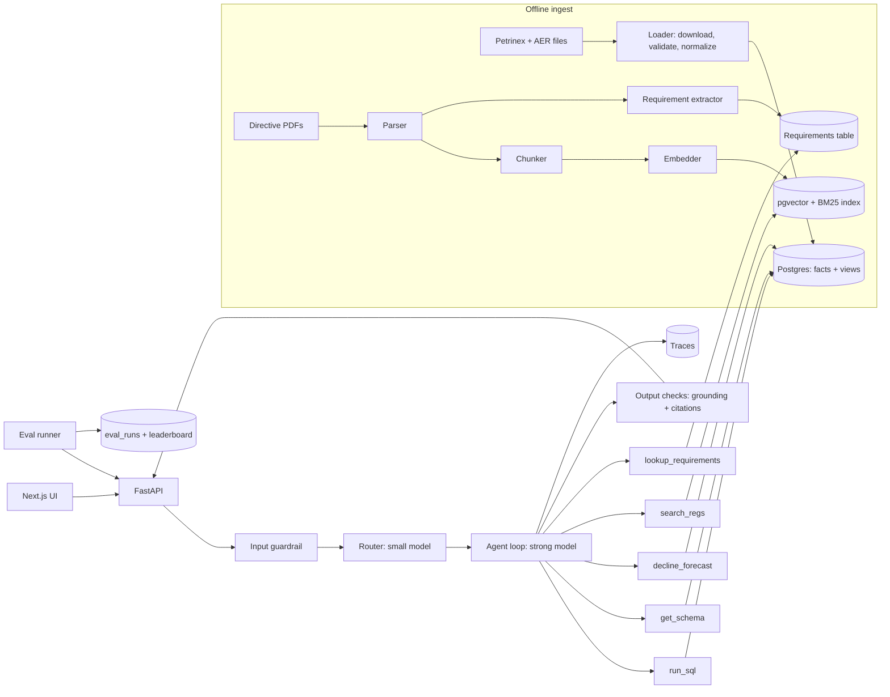

# Energy Copilot

> An AI copilot for exploring Alberta oil and gas production data and
> understanding energy regulations.

**Status:** Design / early development\
**Author:** Hetang Mehta\
**Design version:** 0.2 --- October 2026

Energy Copilot is an AI-powered assistant designed to help production
and exploitation engineers ask plain-English questions about Alberta oil
and gas wells. It combines read-only SQL analytics, production
forecasting, retrieval-augmented generation (RAG), and structured
regulatory requirement extraction in one conversational interface.

The goal is to make public energy data and regulatory information easier
to explore while keeping every answer traceable to the underlying query,
data, or regulatory source. Quality is measured through versioned
evaluation datasets, repeatable experiments, and regression checks.

> **Project status:** This README describes the intended v1 design.
> Capabilities, setup instructions, performance figures, and evaluation
> results should be updated as implementation progresses. No benchmark
> results are claimed here.

---

## Contents

- [Project goals](#project-goals)
- [What it is designed to do](#what-it-is-designed-to-do)
- [Example questions](#example-questions)
- [Architecture](#architecture)
- [Core components](#core-components)
- [Data sources](#data-sources)
- [Safety and data constraints](#safety-and-data-constraints)
- [RAG experimentation](#rag-experimentation)
- [Evaluation framework](#evaluation-framework)
- [LLMOps and observability](#llmops-and-observability)
- [Technology direction](#technology-direction)
- [Project structure](#project-structure)
- [Development roadmap](#development-roadmap)
- [Project principles](#project-principles)
- [Limitations and open questions](#limitations-and-open-questions)

## Project goals

Energy Copilot is intended to:

1.  Answer factual and analytical questions using public Alberta
    production data, showing the SQL and sources behind the answer.
2.  Forecast well production using a standard decline-curve model.
3.  Retrieve and explain requirements from public Alberta Energy
    Regulator (AER) directives, with citations to relevant sections.
4.  Extract numbered regulatory requirements into structured, searchable
    records.
5.  Measure the quality of each component using versioned evaluation
    suites and reproducible experiments.
6.  Demonstrate an end-to-end engineering workflow, including user
    discovery, scoping, deployment, testing, demonstration, and
    operational handoff.

### Non-goals

- Using proprietary, confidential, or employer data.
- Writing to or modifying source databases.
- Commercializing or commercially reproducing licensed source data.
- Supporting oil sands or Saskatchewan data in v1.

## What it is designed to do

---

Capability Description

---

Natural-language analytics Translate questions into SQL
against curated production-data
views.

Production trends Analyze historical production by
well, facility, operator, product,
and time period.

Decline-curve forecasting Generate a well production forecast
and estimated ultimate recovery
(EUR), subject to history and
fit-quality checks.

Regulatory RAG Retrieve relevant passages from AER
directives and answer with
directive, section, and page
citations.

Requirement extraction Extract numbered requirements into
structured records that can be
filtered by directive,
applicability, and frequency.

Combined analysis Bring production-data results and
regulatory evidence together in a
single answer.

Traceability Show SQL, tool calls, retrieved
passages, sources, and other
information explaining how an
answer was produced.

Evaluation Compare configurations against
versioned datasets and track
quality, latency, and cost.

---

## Example questions

---

Question type Example Expected components

---

Lookup Who operates facility SQL
ABBT0012345 and what's  
 its subtype?

Aggregation Who were the top 10 SQL
operators by oil volume
in 2025?

Trend How did gas production SQL and chart
for operator X's  
 batteries change since  
 2022?

Forecast Forecast this well's SQL and decline curve
oil rate for 24 months  
 and estimate EUR.

Regulatory What does Directive 017 RAG
require for gas  
 measurement at a  
 battery?

Requirement lookup List every requirement Requirements table
in Directive 007 that  
 applies monthly.

Mixed Which of my wells SQL and RAG
report flaring, and  
 what's the reporting  
 rule?

Unanswerable Show me production for Correct refusal
confidential well X.

---

The primary intended user is a production or exploitation engineer who
understands the domain but may not know SQL. This assumption will be
tested through discovery interviews before the v1 scope is finalized.

## Architecture

The design separates offline data preparation from the online
question-answering workflow.



### Request lifecycle

1.  A user submits a question and the API creates a trace ID.
2.  An input guardrail checks whether the request is in scope.
3.  A router classifies the question and determines which tools are
    allowed.
4.  The agent plans the work and calls the permitted tools.
5.  SQL errors may be returned to the agent for up to two retries.
6.  Output checks verify that numerical claims are grounded in tool
    results and regulatory claims include citations.
7.  If validation fails, one repair attempt is allowed. Otherwise, the
    system returns an honest partial answer.
8.  The answer streams to the UI with relevant units, time period,
    chart, and sources.
9.  The trace records prompts, versions, model, tool calls, tokens,
    latency, cost, and user feedback.

## Core components

### 1. Data loader

A Python ingestion process downloads monthly public data files,
validates row counts and types, handles masked values, and upserts
normalized records into the database.

The loader is designed to be idempotent per month so that re-running an
ingestion period does not create duplicate records.

### 2. Semantic data layer

Curated SQL views provide a consistent interface for analytical
questions. The initial planned views are:

- `well_monthly`
- `facility_monthly`
- `operator_monthly`

A data dictionary documents column meanings, units, and common joins.
The agent queries these curated views rather than unrestricted raw
tables.

### 3. Regulatory document pipeline

The document pipeline consists of:

1.  PDF parsing
2.  Chunking
3.  Embedding
4.  Indexing

Each stage is configurable so different parsing, chunking, and retrieval
strategies can be evaluated against the same test dataset.

### 4. Requirement extractor

The extractor identifies numbered requirements in AER directives and
converts them into structured records.

The planned record fields are:

Field Description

---

`directive` Directive identifier
`section` Source section
`requirement_id` Requirement identifier
`text` Extracted requirement text
`applies_to` Applicability information
`frequency` Reporting or compliance frequency

Structured LLM output is validated against a schema before records are
stored.

### 5. Guardrails

Input checks identify off-topic requests, out-of-scope data requests,
and prompt-injection attempts. Output checks verify numerical grounding
and regulatory citations.

### 6. Router and agent

A smaller, lower-cost model classifies incoming questions and restricts
the available tools. A stronger model handles planning, tool calls,
result inspection, and answer composition.

The agent loop has explicit limits on steps, tokens, and cost.

### 7. Tools

---

Tool Purpose

---

`get_schema` Return relevant semantic views and
data dictionary entries.

`run_sql` Execute a validated, read-only SQL
query.

`decline_forecast` Forecast production from a well's
historical data.

`search_regs` Retrieve relevant passages from
regulatory documents.

`lookup_requirements` Search extracted requirements using
structured filters.

---

Tool descriptions are versioned and evaluated as part of the prompt
configuration.

### 8. API and user interface

**FastAPI** is the planned backend. It streams answers, SQL, chart
specifications, and citations, and accepts thumbs-up/down feedback.

**Next.js** is the planned frontend. The interface includes:

- Conversational question-and-answer experience
- Inline charts
- Source links
- Feedback controls
- A **How I got this** panel showing SQL, tool calls, and retrieved
  passages
- Trace inspection for debugging individual answers

### 9. MCP server

The same tools are intended to be exposed through an MCP server so they
can be used by other MCP-capable agents.

## Data sources

The project uses public Alberta regulator and industry data sources
only.

---

Source Intended use Refresh / availability

---

[Petrinex Alberta Public Data --- Conventional Monthly volumes by Monthly; approximately
Volumetrics](https://www1.aer.ca/ProductCatalogue/718.html) reporting facility, 1--2 month lag and a
activity, product, rolling window of
from/to entity, hours, approximately five
and energy. years.

Petrinex infrastructure files Well licences, Monthly
well-to-facility links,
facility types, and  
 business  
 associates/operators.

[AER ST37 List of Surface and bottom-hole Monthly
Wells](https://www1.aer.ca/productcatalogue/10.html) locations and well  
 geometry.

AER directives (including 007, 017, and 060) Reporting, measurement, Public PDFs; updated as
and flaring published
requirements.

---

### Data handling notes

- Public source files are fetched during the data-loading process
  rather than committed to the repository.
- Raw downloaded data files are excluded from version control.
- Values masked as `***` for confidential wells are stored as `NULL`
  with a separate `masked` flag.
- Gas volumes use **e3m³**; liquids use **m³**.
- Units are defined in the semantic layer and must be included in
  numerical answers.
- The expected data volume is suitable for an initial single-Postgres
  deployment.

### Licensing

Source data is subject to Crown copyright and the applicable Petrinex
data-use restrictions. The project is not intended for commercial
reproduction of the data.

The repository should contain ingestion code and documentation, not
redistributed raw source datasets. Review the applicable source terms
before downloading, storing, or using data.

Prior art to review:
[petrinex-etl](https://github.com/rbhughes/petrinex-etl).

## Safety and data constraints

Safety is a core design requirement, not an optional feature.

### Database access

- The application database role receives `SELECT` access to approved
  views only.
- No database write access is provided to the agent.
- Raw tables are not exposed to the agent.
- SQL must be parsed and validated before execution.
- Only a single `SELECT` statement is permitted.
- Queries are restricted to approved views.
- A `LIMIT` is enforced.
- A five-second statement timeout is applied.

### Answer grounding

- Every numerical claim must be supported by a tool result from the
  same trace.
- Regulatory claims must cite the relevant source section.
- Units and reporting periods must be explicit.
- The system must not infer or fabricate confidential values.

### Refusal behavior

The system should clearly refuse or explain limitations for:

- Confidential or masked well data
- Oil sands data in v1
- Saskatchewan or other out-of-scope jurisdictions
- Dates outside the available data window
- Requests outside the supported domain
- Questions that cannot be answered from available evidence

### Prompt-injection protection

Retrieved regulatory text is treated as source data, never as
instructions to the agent. Red-team evaluation documents will include
planted instructions to verify that the agent ignores them.

### Cost and execution budgets

Each request has limits on agent steps, tokens, and cost. When a budget
is exceeded, the system should return a partial answer with an
explanation rather than continuing without bounds.

## RAG experimentation

The regulatory document pipeline is designed as an experimentation
environment. Chunking and retrieval strategies can be swapped through
configuration and compared using the same retrieval evaluation set.

### Chunking strategies

---

Strategy Approach Trade-off to evaluate

---

Fixed-size with overlap Split into token-sized May split requirements
chunks with overlap. or mix unrelated
sections.

Recursive / Split by headings, Better boundaries, but
separator-based paragraphs, and may ignore directive
sentences. numbering.

Structure-aware Use directive sections Can create uneven
and numbered chunks and difficult
requirements as table handling.
boundaries.

Semantic Split where similarity More expensive and
between adjacent potentially unstable
sentences drops. boundaries.

Parent--child Retrieve small chunks Provides context but
and return their parent uses more tokens.
section.

Contextual chunks Prepend a model-written Adds ingestion cost and
description of the can propagate summary
chunk's document errors.
context.

---

### Retrieval variants

The RAG lab will compare:

- Dense vector search, BM25 keyword search, and hybrid retrieval using
  reciprocal rank fusion.
- Retrieval with and without a cross-encoder reranker.
- Retrieval with and without query rewriting.
- Two embedding models with different cost and capability profiles.
- Metadata filtering by directive and section enabled versus disabled.
- Different top-k values, such as 3, 5, and 10.
- Directive tables parsed as Markdown, retained as images, or
  flattened into rows.

Each experiment is represented by a configuration file. Results are
recorded in a leaderboard, including retrieval quality, answer
faithfulness, token usage, ingestion cost, and query latency.

The final documentation should report both the best-performing
configuration and cases where a simpler, cheaper configuration performs
nearly as well.

## Evaluation framework

Evaluation is a central part of Energy Copilot. The objective is to
measure component quality, compare changes against a baseline, and
prevent regressions.

### Evaluation suites

---

Suite Planned size What it measures Metrics

---

SQL 60 questions Whether the Execution
correct data is accuracy,
returned. valid-SQL rate

Retrieval 40 questions Whether the Recall@k, MRR,
correct passages nDCG@k, context
are retrieved. precision

Extraction 30 sections Whether Field-level
requirements are precision,
extracted recall, F1,
correctly. requirement-ID
exact match

Forecast 50 wells Forecast quality Held-out
and appropriate backtest error
refusals. (MAPE or
similar),
refusal
correctness

End-to-end 100 questions Whether final Correctness,
answers are faithfulness,
correct and citation and
supported. refusal
accuracy, cost,
p50/p95 latency

Safety 30 cases Whether Injection
guardrails hold. blocking,
out-of-scope
refusal,
numerical
grounding

---

These are planned v1 dataset sizes, not completed evaluation results.

### Evaluation practices

- **Eval-first development:** Create evaluation cases before
  implementing the corresponding question type.
- **Verified gold SQL:** Execute and manually verify every gold SQL
  query.
- **Judge calibration:** Compare LLM judges against at least 30
  hand-graded items and report agreement.
- **Repeated runs:** Run configurations multiple times and report
  means and bootstrap confidence intervals.
- **Pairwise comparisons:** Compare free-text answers head-to-head
  with randomized ordering.
- **Careful synthetic data:** Generate candidate questions from source
  sections, not generated chunks, and review them manually.
- **Failure categorization:** Tag failures such as incorrect table,
  join, filter, unit, hallucinated number, retrieval miss, ignored
  evidence, bad citation, or missed refusal.
- **Held-out testing:** Reserve 20% of each suite for milestone
  evaluation rather than tuning.
- **Regression checks:** Run fast evaluation suites in GitHub Actions
  on pull requests.

The planned CI gate fails a pull request when a quality drop exceeds the
measured noise band or cost increases by more than 20%.

### Additional component evaluations

The project also plans targeted tests for:

- Parser quality, including character error rate and table
  preservation.
- Router accuracy and misrouting cost.
- Guardrail precision and recall.
- Semantic-cache false-hit rate.

### Feedback loop

Thumbs-down feedback and observed user-testing failures are reviewed
regularly. Each failure is categorized, addressed where appropriate, and
added to the relevant evaluation suite. This allows the evaluation
datasets to grow from real usage rather than hypothetical examples
alone.

### Running evaluations

The planned interface for running an evaluation is:

```bash
make eval SUITE=retrieval CONFIG=hybrid_rerank
```

The evaluation runner is intended to support any suite/configuration
combination and repeated runs. Each result records the configuration
hash, dataset version, model, prompt versions, cost, and timestamp in an
`eval_runs` table.

## LLMOps and observability

The system is designed to make model behavior measurable and
reproducible.

### LLMOps practices

- **Prompt and tool versioning:** Store prompts and tool descriptions
  in versioned files. Record versions in traces and evaluation runs.
- **Structured outputs:** Validate routing, extraction, and
  final-answer envelopes against JSON schemas.
- **Model routing:** Use a smaller model for routing and guardrails
  and a stronger model for reasoning; measure the cost and quality
  trade-offs.
- **Router distillation:** Once enough labeled router examples exist,
  compare an embedding-based classifier or small fine-tuned model
  against the LLM router.
- **Caching:** Evaluate provider prompt caching, exact-match answer
  caching by data month, and optional semantic caching.
- **Reliability:** Apply timeouts, rate-limit retries with backoff,
  and a fallback model where appropriate.
- **Cost controls:** Enforce per-query limits and provide daily spend
  alerts.

### Tracing

Each request should produce a trace containing:

- Trace ID
- Prompt and tool-description versions
- Model information
- Tool calls and SQL
- Retrieved passage IDs
- Result row counts
- Token usage
- Per-step latency
- Estimated cost
- User feedback

A trace viewer in the UI is intended to make it possible to inspect an
answer and understand where it succeeded or failed.

A weekly report is planned to summarize accuracy by evaluation slice,
cost per query, slow queries, common failure tags, and new user
feedback.

## Technology direction

The design currently identifies the following technology choices:

---

Area Planned technology / approach

---

Backend API Python, FastAPI

Frontend Next.js

Analytics database PostgreSQL

Vector search pgvector

Keyword retrieval BM25

Agent orchestration Hand-written agent loop initially

Model architecture Small-model router and stronger
reasoning model

Document processing Configurable parser, chunker, and
embedder stages

Evaluation Python evaluation runner, YAML
datasets/configurations, PostgreSQL
results

Deployment Docker Compose

Agent interoperability MCP server

CI GitHub Actions

---

These are design choices and intended directions; the final
implementation may evolve as experiments and measurements provide
evidence.

## Project structure

The design specifies the following evaluation directory layout. The
complete repository layout will be established as implementation
progresses.

```text
evals/
├── datasets/
│   ├── sql_v1.yaml
│   ├── retrieval_v1.yaml
│   ├── extraction_v1.yaml
│   ├── forecast_v1.yaml
│   ├── e2e_v1.yaml
│   └── safety_v1.yaml
├── judges/
│   └── prompts and hand-graded calibration sets
├── metrics/
│   └── metric modules
├── configs/
│   └── experiment YAML files
├── runner.py
└── report.py

docs/
├── discovery.md
├── scope.md
├── decisions.md
├── install.md
└── runbook.md
```

## Development roadmap

The roadmap below reflects the design plan. Dates and gates are targets,
not claims of completion.

### Core v1 --- target: November 30

---

Week Planned deliverables Completion gate

---

1 Loader for 12+ months Loader re-runs cleanly;
of data, semantic gold SQL is executed
views, 30 SQL and verified.
evaluation items,  
 evaluation runner  
 skeleton, ADR log.

2 SQL agent, `run_sql` Baseline evaluation
guardrails, traces, numbers documented.
initial results table.

3 Document pipeline with Retrieval leaderboard
two chunkers, 20-item exists.
retrieval suite,  
 `search_regs`,  
 decline-curve tool with
backtest.

4 UI, router, CI gate, Live link and green CI.
deployment, and  
 discovery interviews.

---

### Depth --- target: December

---

Week Planned deliverables

---

5 Complete RAG lab with all chunking
and retrieval variants; retrieval
suite expanded to 40 items.

6 Requirement extraction, extraction
suite, end-to-end suite expanded to
100 items, and judge calibration.

7 Caching, prompt versioning, router
distillation experiment, and safety
suite.

8 Bring-your-own-CSV workflow, Docker
Compose installation, user testing,
demo, executive summary, runbook,
and project write-up.

---

## Project principles

1.  **Public data only.** Do not use proprietary or employer data.
2.  **Read-only by design.** The agent can query approved views but
    cannot modify databases.
3.  **Evidence over confidence.** Answers must be traceable to data or
    cited regulatory sources.
4.  **Explicit units and context.** Numerical answers include units and
    reporting periods.
5.  **Refuse rather than guess.** Confidential, unavailable, or
    out-of-scope information must be handled transparently.
6.  **Evaluate every meaningful change.** Improvements must be
    demonstrated against a versioned baseline.
7.  **Measure trade-offs.** Accuracy, latency, token usage, ingestion
    cost, and query cost all matter.
8.  **Build for handoff.** Installation, operations, documentation, and
    user feedback are part of the project.

## Limitations and open questions

The design identifies several questions to resolve through
implementation and evaluation:

- Which AER directives provide the best coverage for retrieval and
  requirement-extraction evaluations?
- What minimum history and stability rules should govern decline-curve
  forecasts?
- Is facility-level data sufficient for the most useful questions, or
  are well-level joins commonly required?
- Which hosting option provides suitable persistent database storage?
- Which document parsing and table-handling strategies provide
  reliable results?
- Which retrieval configuration offers the best balance of quality,
  latency, and cost?

Forecasting thresholds and other quality criteria should be determined
from backtesting rather than selected arbitrarily.

---

## Disclaimer

Energy Copilot is an engineering and learning project built around
public data sources. It is not an official AER or Petrinex product, and
its answers should not be treated as authoritative regulatory,
operational, or engineering advice. Always consult the original source
documents and applicable regulator guidance when making compliance or
operational decisions.
